<picture>
  <source media="(prefers-color-scheme: dark)" srcset="https://streak-stats.demolab.com/?user=Hem60&hide_border=true&background=0A101F&stroke=22D3EE&ring=A78BFA&fire=22D3EE&currStreakLabel=22D3EE&sideLabels=94A3B8&currStreakNum=F8FAFC&sideNums=F8FAFC&dates=64748B" />
  <source media="(prefers-color-scheme: light)" srcset="https://streak-stats.demolab.com/?user=Hem60&hide_border=true&background=FFFFFF&stroke=7C3AED&ring=7C3AED&fire=0891B2&currStreakLabel=0F172A&sideLabels=475569&currStreakNum=0F172A&sideNums=0F172A&dates=64748B" />
  
</picture>

<picture>
  <source media="(prefers-color-scheme: dark)" srcset="https://github-readme-stats.vercel.app/api?username=Hem60&show_icons=true&hide_border=true&hide_rank=true&bg_color=0A101F&title_color=22D3EE&icon_color=A78BFA&text_color=94A3B8" />
  <source media="(prefers-color-scheme: light)" srcset="https://github-readme-stats.vercel.app/api?username=Hem60&show_icons=true&hide_border=true&hide_rank=true&bg_color=FFFFFF&title_color=0F172A&icon_color=7C3AED&text_color=475569" />
  
</picture>
<picture>
  <source media="(prefers-color-scheme: dark)" srcset="https://github-readme-stats.vercel.app/api/top-langs/?username=Hem60&layout=compact&hide_border=true&bg_color=0A101F&title_color=22D3EE&text_color=94A3B8" />
  <source media="(prefers-color-scheme: light)" srcset="https://github-readme-stats.vercel.app/api/top-langs/?username=Hem60&layout=compact&hide_border=true&bg_color=FFFFFF&title_color=0F172A&text_color=475569" />
  
</picture>

  

  
  
  

---

## 👋 About

I'm **Hem Patel**, an AI/ML engineer in training studying **B.E. Computer Engineering** alongside **IIT Mandi (AI-DS)**, two undergraduate degrees in parallel.

I build RAG systems, evaluation harnesses and ML services, and I publish the numbers, including the ones that don't look good.

**Currently:** shipping small AI/ML builds and learning in public.

### 🛠️ Engineering Focus

- Retrieval-Augmented Generation (RAG) and grounded LLM answers
- Evaluation harnesses: LLM-as-judge scoring that reports errors separately
- ML services: REST APIs with FastAPI / Flask, containerised with Docker
- CI/CD for ML: tests on every push, images built and deployed automatically

### 🤝 Open To

- AI/ML engineering internships
- RAG / LLM application projects
- Open-source and hackathon collaboration

---

## 🧰 Tech Stack

**Languages**

  

**Backend & Frameworks**

  

**ML & AI**

  
  
  

**DevOps & Tooling**

  

**AI-assisted development:** Claude Code · Gemini CLI · GitHub Copilot

---

## 🧠 AI/ML Expertise

| Domain | Applied in | Details |
|---|---|---|
| **RAG** | [RAG QA Chatbot](https://github.com/Hem60/RAG-CHAT-BOT) | PDF ingestion, CPU embeddings (`all-MiniLM-L6-v2`), FAISS retrieval, grounded answers from `gemma-2-9b-it`, refuses when the documents lack the answer |
| **LLM evaluation** | [RAG QA Chatbot](https://github.com/Hem60/RAG-CHAT-BOT) | LLM-as-judge harness reporting errors separately: 6 of 10 questions scored, **3.5/5 scored, 2.5/5 penalised** |
| **Recommender systems** | [Movie Recommender](https://github.com/Hem60/MOVIE_RECOMMENDER) | Item-based collaborative filtering on MovieLens 100k, evaluated with **Precision@10** |
| **Classical ML** | [Iris Predictor](https://github.com/Hem60/IRIS-PREDICTOR) | RandomForest classifier, ~96% test accuracy |
| **MLOps** | [Iris Predictor](https://github.com/Hem60/IRIS-PREDICTOR) | Pytest on every push, Docker image built in CI and pushed to GHCR, deployed on Render |

---

## 🚀 Featured Projects

| | |
|---|---|
| **[RAG QA Chatbot](https://github.com/Hem60/RAG-CHAT-BOT)** Fully local retrieval-augmented QA over technical PDFs, on a 100% free-tier stack.     | **[Movie Recommender](https://github.com/Hem60/MOVIE_RECOMMENDER)** Item-based collaborative filtering with genre filtering, served via a FastAPI REST API and web UI.     |
| **[Iris Predictor](https://github.com/Hem60/IRIS-PREDICTOR)** End-to-end MLOps pipeline: Flask + Gunicorn API, CI tests, Docker image on GHCR, live on Render.     | **raksha-ai** *(private, team project)* Financial safety AI assistant. Contributor: login/signup, scan input, result report, history and about screens (5 commits). |

---

<b>Build intelligent systems. Engineer for reliability. Evaluate what you ship.</b>

